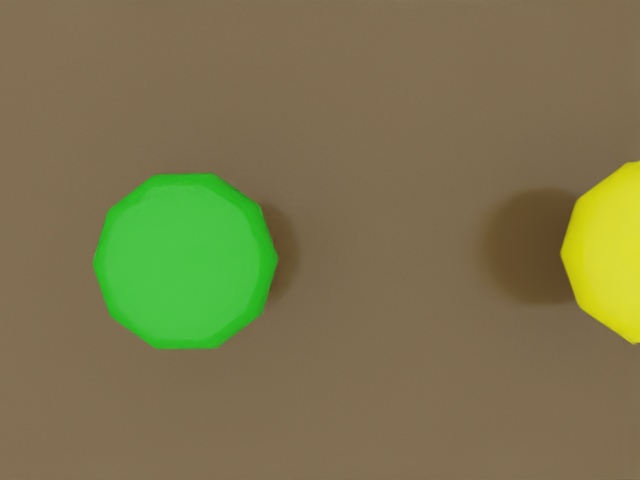

# Recorded simulator evidence

These results came from the actual Isaac PhysX/Pegasus/PX4 SITL aircraft on the
audited workstation, with rendered cameras and native PX4 estimation/control.
They are separate from the ideal vehicle used by the executive contract tests.

| Trial | Result | Evidence |
|---|---|---|
| Stage 1 complete survey | 58 observations, 15 plants: 11 healthy / 4 stressed. Known-station landing, disarm, recharge and READY. | [Summary](normal-mission-evidence.json) |
| Low battery + visual docking | Injected 25%; return, 151 visual descent updates, 3.35 cm final horizontal station error; battery 23.29% → 95.29%. | [Summary](precision-low-battery-evidence.json) |
| Repeated mission from READY | 56 observations, all 15 plants and the same 11/4 split. Complete coverage, visual docking, disarm and READY; 5.16 cm final horizontal station error. | [Summary](precision-normal-evidence.json) |
| Mission node killed | Gateway lease expired, native LAND, landing/disarm; 3.47 cm horizontal drift from injection. | [Summary](mission-crash-evidence.json) |
| Simulator paused 3 s | Wall-time state watchdog fired; native landing/disarm after resume. | [Summary](pause-evidence.json) |
| Gateway killed | Native PX4 offboard-loss landing and disarm confirmed directly from DDS output. | [Summary](gateway-crash-evidence.json) |
| Critical battery | Injected 10% during takeoff. Emergency landing/disarm, MISSION_ABORTED, no fictitious charging. | [Summary](emergency-battery-evidence.json) |

The repeated mission ran without resetting the simulator after the low-battery
sortie. The centimetre values describe these deterministic simulation trials,
not a promised hardware accuracy. Raw observer samples, images, SQLite files,
full state/landing traces, PX4 ULogs and console logs remain in the local ignored
paths identified by each summary. Re-run `scripts/mission_demo.py` to generate
fresh full evidence on another machine.

The frame below is an actual saved RGB observation from the repeated mission:
green and yellow primitive canopies encode healthy/stressed synthetic targets.
No truth-label topic was used by the detector.

QGC 5.0.8 displayed the connected PX4 1.14.3 vehicle; RViz displayed calibrated
RGB, map/body/optical frames, the route and live odometry. A short live rosbag
contained 1,199 messages including 24 RGB and 24 depth frames, camera calibration,
TF, planned path, state, mission and safety topics. No detections occurred during
that landing-only recording; the separate inspection image/record evidence above
covers perception.
